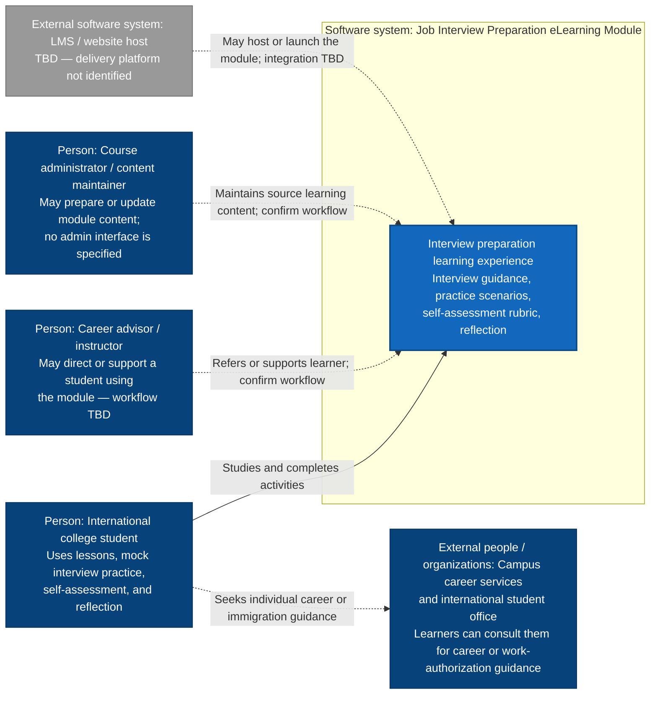
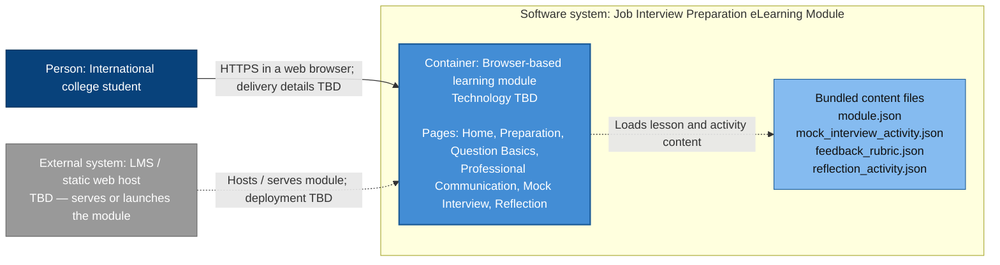

# Interview Preparation eLearning Module — C4 Diagrams

These are working diagrams based on the draft module and the initial C4 sketch. The repository contains learning content in JSON, but does not define a deployed website, LMS, identity provider, analytics service, database, or email integration. Technical details marked **TBD** need confirmation before these diagrams describe an implementation.

## System context

The system is the learning module itself. Students are the primary users. Advisors and course administrators appear in the initial sketch; their roles below are provisional because the content files do not specify advisor workflows or an administration interface. The campus offices are shown as people/organizations learners may consult, not as connected software systems.

## Container view — conceptual deployment

Only one runtime container is justified by the current materials: a browser-based learning experience. The content JSON is shown inside that container as bundled content rather than as a separate service or database. The delivery platform and implementation technology remain **TBD**. No response storage, learner account system, analytics, or external communication service is shown because the project files do not define them.

## Decisions to confirm

- What will deliver the module: an existing LMS, an institutional website, or another platform?
- Are advisors and administrators actual users of the system, or should they remain outside the system as support roles?
- Should mock interview and reflection responses be saved between visits? The current draft does not define persistence.
- Is sign-in required, and if so, is it provided by the host platform?
- Does the project need any email, analytics, or dashboard integration? These appear in the sketch but are not present in the module requirements; AI-generated feedback is explicitly out of scope.

Until these are answered, treat the context and container diagrams as a scope-aligned concept, not a record of the implemented architecture.
